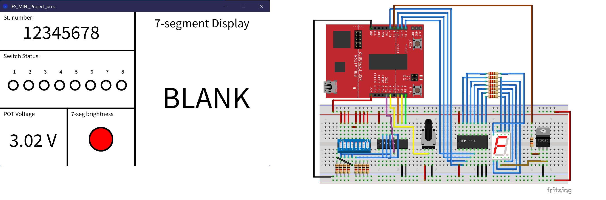
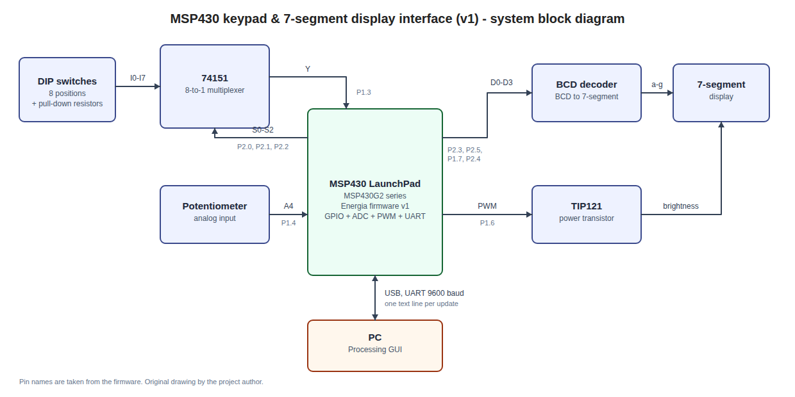
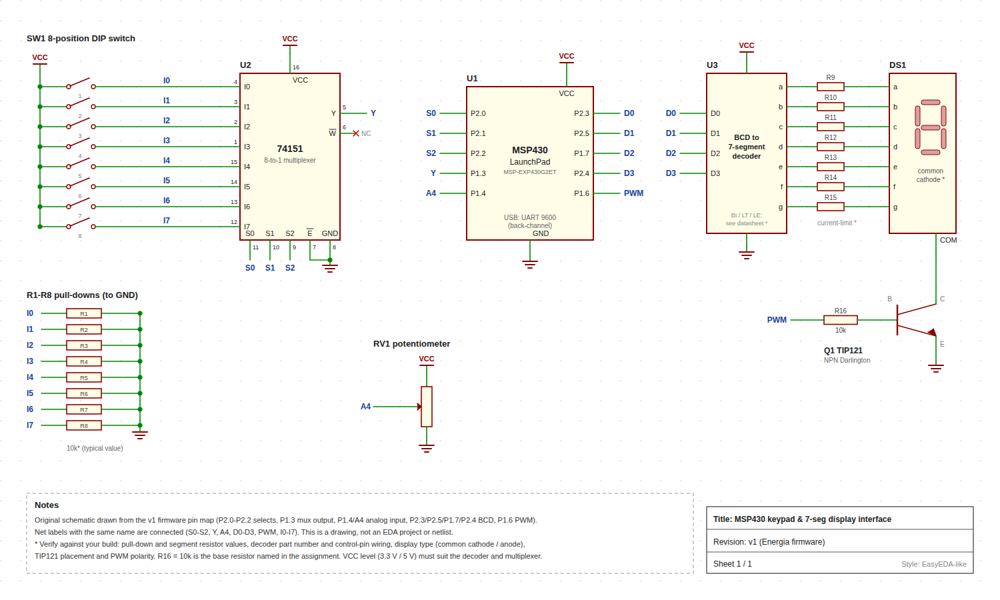

# MSP430 Keypad & 7-Segment Display Interface (v1)

An embedded-systems mini project: an MSP430 LaunchPad reads eight DIP switches through a multiplexer, shows the active switch on a 7-segment display through a BCD decoder, controls the display brightness with PWM from a potentiometer, and streams everything over UART to a PC where a Processing GUI visualises the state.

> **Status:** v1, first-year coursework (TU Dublin, Embedded Systems), written with Energia.
> **v2 (in progress):** bare-metal rewrite on MSP430 registers. See the [roadmap](#roadmap-v2).



## What it does

| Feature | How |
|---|---|
| Boot sequence | Shows a student-ID-style digit sequence on the display with blanks between digits (500 ms per step) |
| Switch reading | Counts the multiplexer selects `S0–S2` from 0 to 7 and reads the multiplexer output `Y` into an 8-element array |
| Display | If **exactly one** switch is on, its number (1–8) is sent to the BCD decoder; otherwise the display is blank |
| Brightness | Potentiometer on ADC channel A4 sets the PWM duty on a TIP121 power transistor driving the display |
| UART | One text line per update at 9600 baud |
| GUI (Processing) | Eight switch indicators, the displayed digit, the potentiometer voltage, and a brightness indicator |

## Hardware

- MSP430 LaunchPad (MSP-EXP430G2ET) programmed with Energia
- 74151 8-to-1 multiplexer and an 8-position DIP switch with pull-down resistors
- BCD-to-7-segment decoder and a 7-segment display
- TIP121 power transistor with a base resistor for PWM brightness control
- Potentiometer on analog channel A4

### Pin map (as used in the code)

| Signal | Pin | Direction |
|---|---|---|
| BCD D0 | `P2_3` | output |
| BCD D1 | `P2_5` | output |
| BCD D2 | `P1_7` | output |
| BCD D3 | `P2_4` | output |
| Mux select S0 | `P2_0` | output |
| Mux select S1 | `P2_1` | output |
| Mux select S2 | `P2_2` | output |
| Mux output Y | `P1_3` | input (pull-up enabled) |
| TIP121 base (PWM) | `P1_6` | output |
| Potentiometer | `P1_4` (A4) | analog input |

### System block diagram



### Schematic



The schematic was drawn from the firmware pin map and is a drawing, not an EDA project or a netlist. Items marked with `*` on the drawing (pull-down and segment resistor values, decoder control pins, display type, TIP121 placement and PWM polarity) should be checked against the physical build. Net labels with the same name are connected.

## How it works

1. **Setup:** configures the pins, opens the serial port at 9600 baud and plays the boot sequence by writing each digit's four bits (`bitRead`) to D0–D3.
2. **Main loop, every cycle:**
   1. Reads the potentiometer: `sampleValue = analogRead(A4)`, voltage `Vpot = sampleValue × 0.00322`, PWM value `255 − sampleValue/4`.
   2. Scans the multiplexer: for `sel = 0..7`, writes the 3-bit select, waits 10 ms for the line to settle and stores `digitalRead(Y)` in `sw_stat[sel]`.
   3. `checkSwitches()` returns the switch number (1–8) when exactly one switch is on, otherwise `10`, which is used as the "blank" code.
   4. Writes the code to D0–D3 and sends one line over serial.

### Serial protocol

```
b1 b2 b3 b4 b5 b6 b7 b8 displayCode adcValue voltage\n
```

| Field | Meaning |
|---|---|
| `b1…b8` | Switch states, `1` = on |
| `displayCode` | `1–8` = the active switch, `10` = blank |
| `adcValue` | Raw 10-bit ADC reading (0–1023) |
| `voltage` | Potentiometer voltage in volts |

Example: `0 0 1 0 0 0 0 0 3 512 1.65`

## Software

| Part | Tech | Folder |
|---|---|---|
| Firmware | C/C++ (Energia) | [`firmware/`](firmware/) |
| GUI | Processing (`processing.serial`) | [`gui/`](gui/) |

## Build and run

1. Open `firmware/mini_project_v1/mini_project_v1.ino` in Energia, select the MSP430 LaunchPad board, upload.
2. Open `gui/mini_project_gui/mini_project_gui.pde` in Processing and set the serial port in `setup()` (the index into `Serial.list()` depends on your machine).
3. Flip the switches and turn the potentiometer; the GUI should follow.

## Known limitations (v1)

- **Blocking code:** `delay()` is used for multiplexer settling (10 ms × 8) and for the loop period; switches are polled without debouncing.
- **Dynamic strings:** the serial output is built with Arduino `String` objects. On a device with a few hundred bytes of RAM this is risky because of heap allocation.
- **Ambiguous code:** `10` means both "no switch on" and "more than one switch on".
- **Magic numbers:** the ADC-to-volt factor and the blank code are hard-coded.
- **GUI robustness:** the serial port is selected by a hard-coded index and received lines are parsed without checking the number of fields, so a partial line can crash the sketch.
- **Abstraction level:** all I/O goes through Energia functions (`digitalWrite`, `analogRead`, `analogWrite`); no direct register access, timers or interrupts.

## Roadmap (v2)

- [ ] Register-level code (`P1OUT`/`P2OUT`, `ADC10`, `TimerA`), no Energia API.
- [ ] Timer-interrupt-driven multiplexer scan and PWM; debounce in software.
- [ ] UART transmit with an interrupt and a ring buffer; fixed-size buffers, no `String`.
- [ ] Framed protocol with a start marker and checksum; robust parsing in the GUI.
- [ ] Measure and publish flash and RAM usage and scan-loop timing.
- [ ] Separate "none" and "multiple" states.

## Repository structure

```
msp430-keypad-display-v1/
├── README.md
├── LICENSE
├── firmware/mini_project_v1/mini_project_v1.ino
├── gui/mini_project_gui/mini_project_gui.pde
└── docs/images/               # block-diagram.svg/.png, schematic.svg/.png, photo of the board, GUI screenshot
```

## License

MIT.

## Author

Illia Andrushko — Electronic and Computer Engineering, Dublin City University (previously TU Dublin).
